

  

  
  
  
  
  

### `$ whoami`

Sou **Pedro Netto**, de Bauru/SP. Mantenho infraestrutura de pé como **Analista de Infraestrutura II na Paschoalotto**: incidentes críticos via ServiceNow, mudanças (CHG) em ITIL v4, Active Directory, Microsoft 365 e FortiGate.

Fora do expediente, construo sistemas que pensam — e que rodam na minha máquina, não na nuvem dos outros. O maior deles é o **[Alfred](https://github.com/PedroNettoDs/Alfred-Pennyworth)**, meu assistente pessoal com LLMs locais. Também fundei a **AttanoTech**, onde o **[SubMAX](https://www.submax.com.br)** já roda em produção.

- Curso **Tecnologia em Redes de Computadores** na FATEC Bauru, com a trilha **CCNAv7** concluída.
- Miro em **CI/CD, LLMs e agentes, automação com Python, cloud e gestão de projetos**.
- Kubuntu é meu daily driver. Sim, vou reclamar do Windows em toda oportunidade.

  

### `$ ./alfred --arquitetura`

  <a href="https://github.com/PedroNettoDs/Alfred-Pennyworth"></a>

O **Alfred** é a prova do que eu defendo: um assistente que lê meu e-mail e meu WhatsApp, pesquisa na web e lembra das coisas — sem mandar nada para uma API de IA de terceiros.

- **Conversa com ferramentas** — executa comandos no host sob whitelist, faz pesquisa profunda e consulta o RAG local (SQLite FTS5 + ChromaDB).
- **E-mail** — lê o Thunderbird, monta um jornal diário das newsletters e cria pendências "vou / não vou". Uma extensão do Thunderbird redige as respostas.
- **WhatsApp** — via Evolution API, transcreve áudios localmente e pergunta *"o que você quer responder?"*. Nada sai sem a minha aprovação.
- **Laya** — classificador ModernBERT local para decisões rápidas e tipadas.
- **Painel web** para aprovar o que ele propõe, memória num vault do Obsidian e o **[Pestinha](https://github.com/PedroNettoDs/pestinha)**, um pet de tela que reage à atividade dele.

`Python` · `FastAPI` · `Ollama` · `Docker` · `systemd` · licença **AGPL-3.0**

### `$ ls ~/projetos`

  <a href="https://www.submax.com.br"></a>
  <a href="https://github.com/PedroNettoDs/Capitaine"></a>
  <a href="https://github.com/PedroNettoDs/MatchNetto"></a>
  <a href="https://github.com/PedroNettoDs/LLM-briefing"></a>
  <a href="https://github.com/PedroNettoDs/AlexandrIA"></a>
  <a href="https://github.com/PedroNettoDs/Sentt"></a>
  <a href="https://github.com/PedroNettoDs/NF-e-Consolidator"></a>
  <a href="https://github.com/PedroNettoDs/IaC-Fileserver-Fatec"></a>

Mais em `ls -a`: [Exchange Retention Manager](https://github.com/PedroNettoDs/Exchange-Retention-Manager) · [lab-http-https](https://github.com/PedroNettoDs/lab-http-https) · [oggtranscritor](https://github.com/PedroNettoDs/oggtranscritor) · [yTubeRaptor](https://github.com/PedroNettoDs/yTubeRaptor) · [Hub-Pessoal](https://github.com/PedroNettoDs/Hub-Pessoal)

### `$ ls ~/projetos/no-forno`

- **App nativo do SubMAX** — Flutter para iOS e Android, levando o portal do aluno para as lojas.
- **Linker** — plataforma de intermediação de serviços: NestJS + Prisma, Flutter, PostGIS e mapas OpenStreetMap próprios.
- **Oran** — mensageiro privado e self-hosted sobre Matrix, acessível só por VPN.

### `$ cat pilha.osi`

  

**Certificações:**
[CCNA: Introduction to Networks](https://www.credly.com/badges/3dee7804-554c-4868-ba70-3f0d0a5bfea8) ·
[CCNA: Switching, Routing, and Wireless Essentials](https://www.credly.com/badges/a6d10622-e238-4ddc-a47a-ecc6c7c61935) ·
[CCNA: Enterprise Networking, Security, and Automation](https://www.credly.com/badges/883eb270-a7eb-44cb-a0f3-19a1f8cfe019) ·
[Cisco IT Essentials](https://www.credly.com/badges/866df61a-2ab3-471e-80d3-f864148e6eab) ·
[Huawei Computer Network](https://www.credly.com/badges/ac3bff27-909e-4aa5-8c35-cb0b2fa37a23) ·
[AWS Knowledge: Cloud Essentials](https://www.credly.com/badges/eaa33ec3-74e7-4784-9e60-d1fd389f5b7f)

### `$ git log --graph carreira`

  

### `$ contato --agora`

> Quer saber como posso ser mais do que um funcionário e virar um **investimento** para a sua empresa? Então é só marcar uma conversa. Mas só vale a pena se a sua empresa realmente **exalar tecnologia** — porque é isso que eu respiro.

[nettotech.com.br](https://nettotech.com.br) · [LinkedIn](https://www.linkedin.com/in/pedronettods/) · [contato@nettotech.com.br](mailto:contato@nettotech.com.br)

  

